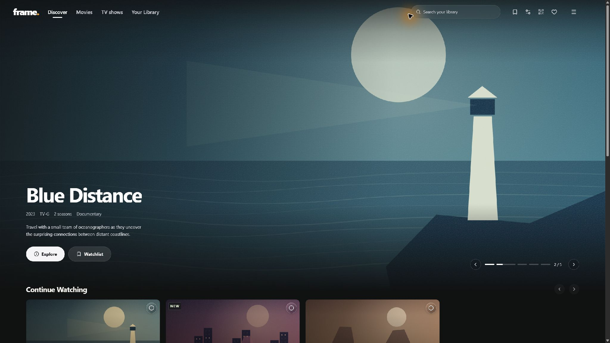

# frame.

A customizable browser client for Jellyfin, installed as a server plugin. Open `/Frame/Web/` on your Jellyfin server. The original `/web/` interface stays available.

Tested with Jellyfin Server 12.3. Supports movies, series and music libraries, browser playback, resume, audio/subtitle controls, favorites, a local watchlist and home-layout customization. Music includes a persistent player, queue, shuffle and repeat. Skip buttons require valid timings supplied by Jellyfin for the current file.

## Install

Install **Frame** from its Jellyfin plugin catalog, or extract the Release ZIP into the server's plugin directory. Back up first and restart Jellyfin after installation. Open `/Frame/Web/` and sign in with your Jellyfin account. Installed plugins do not need `npm run dev`.

[Installation, updates and rollback](docs/INSTALLATION.md).

## Limits

Playback depends on browser codecs, server transcoding and account permissions. Physical iPhone/Safari coverage is incomplete. This plugin does not change Swiftfin or other native clients. It does not identify every file correctly or detect intros itself.

## Source

[Edit, preview and release](docs/WORKFLOW.md) | [Build instructions](docs/BUILDING.md) | [Release/source mapping](docs/RELEASE-SOURCE.md) | [Licensing](docs/LICENSING.md)

Original code is GPL-3.0-only. Matching source and dependency-source archives accompany the release binary. Third-party notices remain applicable.
