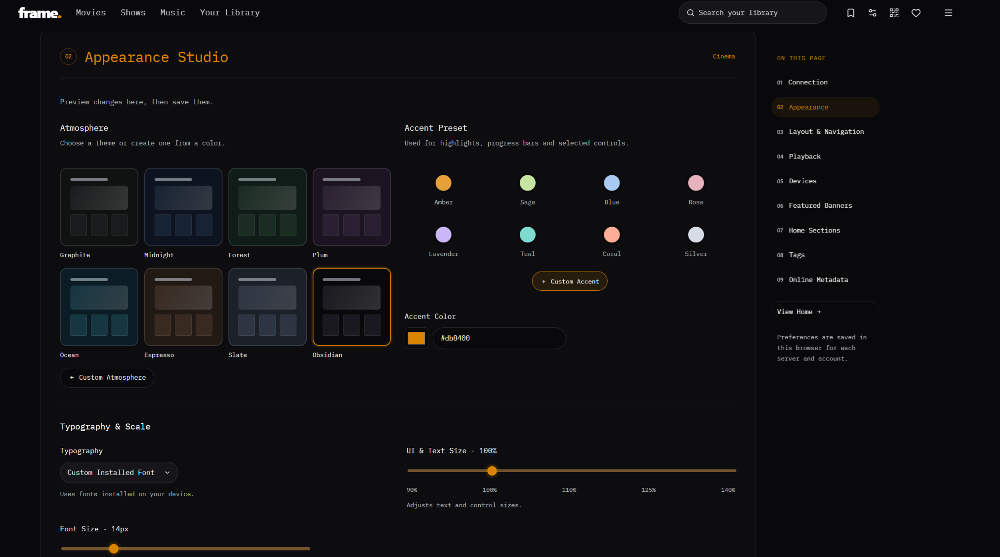
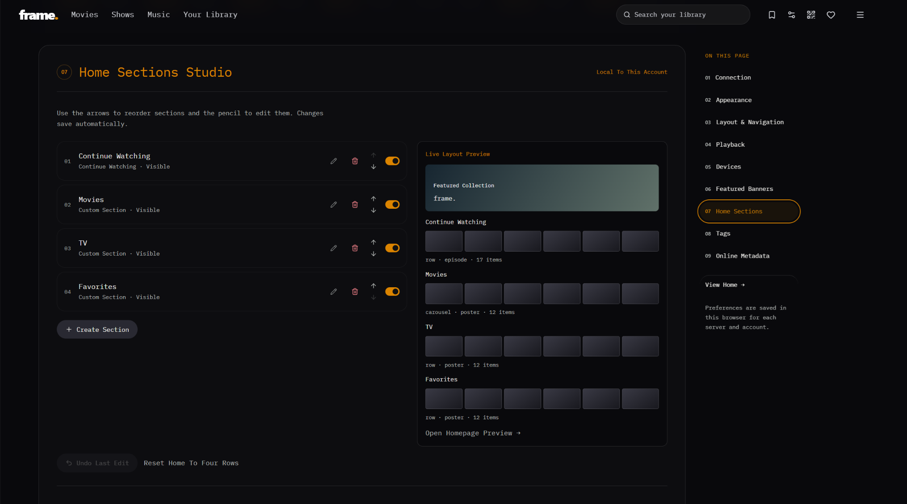
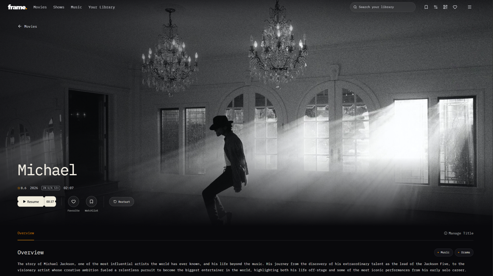
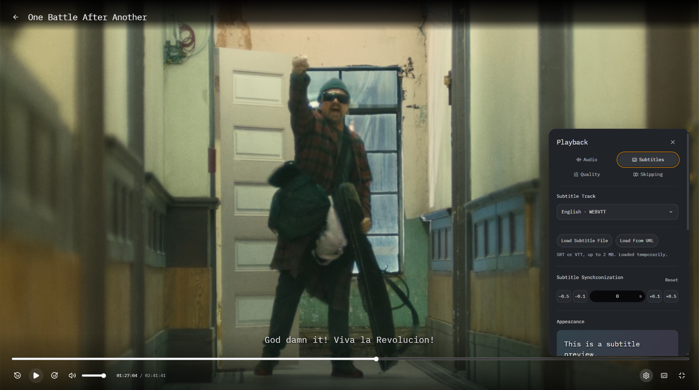

# frame.

A separate web client for Jellyfin, installed as a server plugin. Frame runs at `/Frame/Web/` and leaves the default Jellyfin Web interface unchanged.


## Screenshots

<table>
  <tr>
    <td width="50%" align="center">
      <a href="docs/images/appearance.png"></a>
      <br>Appearance
    </td>
    <td width="50%" align="center">
      <a href="docs/images/home-sections.png"></a>
      <br>Home Sections
    </td>
  </tr>
  <tr>
    <td width="50%" align="center">
      <a href="docs/images/media-details.png"></a>
      <br>Media Details
    </td>
    <td width="50%" align="center">
      <a href="docs/images/playback.png"></a>
      <br>Playback
    </td>
  </tr>
</table>

## Install

Back up Jellyfin, then add this repository in **Dashboard → Plugins → Repositories**:

```text
https://raw.githubusercontent.com/adityas1731/frame./plugin-catalog/manifest.json
```

Install **Frame** from the catalog and restart Jellyfin. Open `/Frame/Web/` on your server and sign in with your Jellyfin account. If Jellyfin uses a BaseUrl, include it before `/Frame/Web/`.

[Installation, updates and rollback](docs/INSTALLATION.md).

## Compatibility and limits

Requires Jellyfin Server 12.3. Other server versions are not verified.

Playback depends on browser codecs, server transcoding and account permissions. Physical iPhone/Safari coverage is incomplete. This plugin does not change Swiftfin or other native clients. It does not identify every file correctly or detect intros itself. Skip buttons require valid timings supplied by Jellyfin for the current file.

## Source

[Edit, preview and release](docs/WORKFLOW.md) | [Build instructions](docs/BUILDING.md) | [Release/source mapping](docs/RELEASE-SOURCE.md) | [Licensing](docs/LICENSING.md)

Original code is [GPL-3.0-only](LICENSE). Matching source and dependency-source archives accompany the [release binary](https://github.com/adityas1731/frame./releases). Third-party notices remain applicable.
