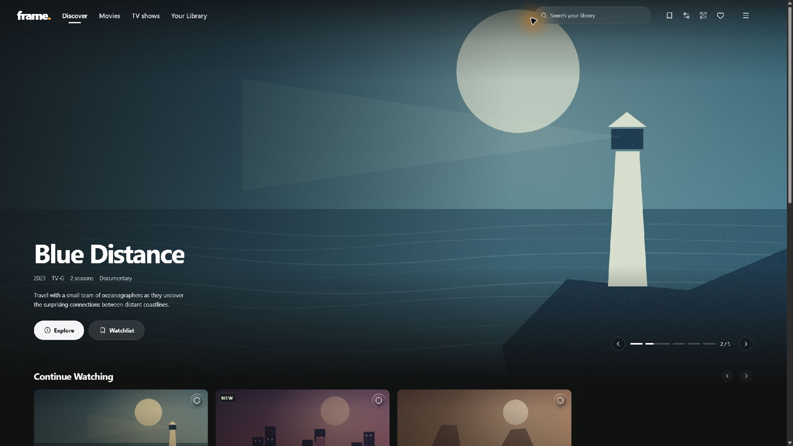

# frame.

A customizable browser client for Jellyfin, installed as a server plugin. Open `/Frame/Web/` on your Jellyfin server. The original `/web/` interface stays available.

Tested with Jellyfin Server 12.3. Includes movies and series, browser playback, resume, audio/subtitle controls, favorites, a local watchlist and home-layout customization. Skip buttons require valid timings supplied by Jellyfin for the current file.

## Install

Download the Release plugin ZIP and `SHA256SUMS`, back up Jellyfin, stop playback and stop the server. Extract into `plugins/Frame_1.0.3.0/`, with `Frame.Jellyfin.dll` directly inside. Keep the previous plugin outside `plugins` for rollback. Restart and open `/Frame/Web/`. [Full instructions](docs/INSTALLATION.md).

The catalog URL will be enabled only after the release is published. This prepared repository does not activate it. Installed plugins do not need `npm run dev`.

## Limits

Playback depends on browser codecs, server transcoding and account permissions. Physical iPhone/Safari coverage is incomplete. This plugin does not change Swiftfin or other native clients. It does not identify every file correctly or detect intros itself.

## Source

[Build instructions](docs/BUILDING.md) · [Release/source mapping](docs/RELEASE-SOURCE.md) · [Licensing](docs/LICENSING.md)

Original code is GPL-3.0-only. Matching source and dependency-source archives accompany each distributed binary. Third-party notices remain applicable.
